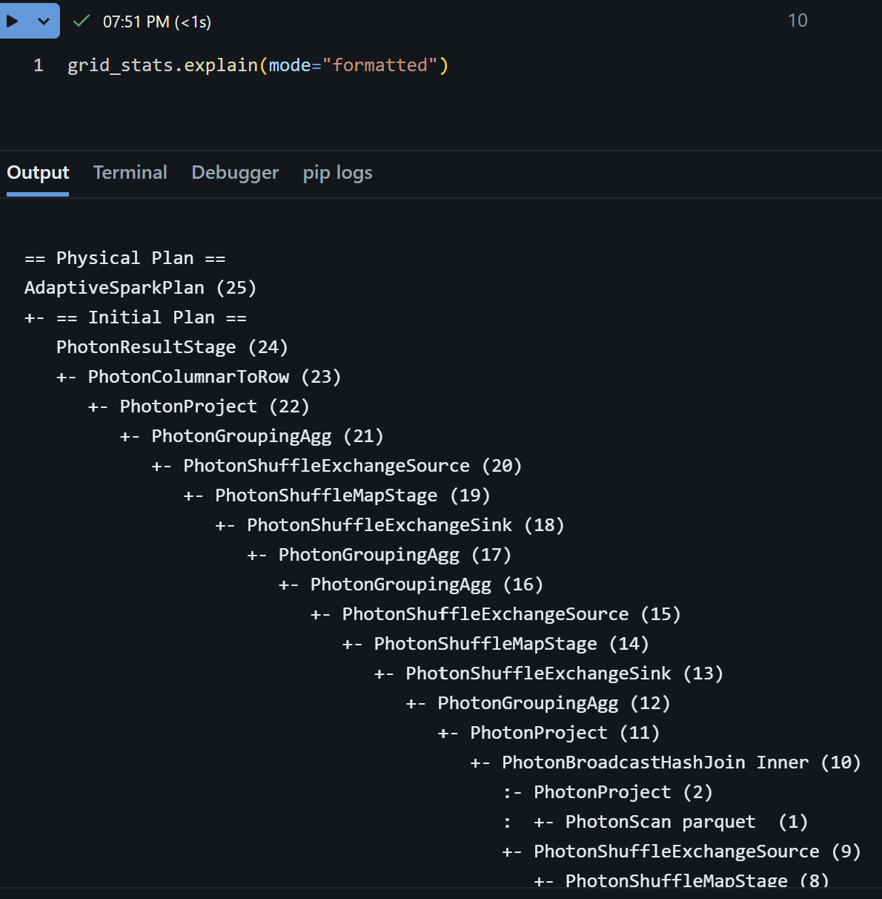
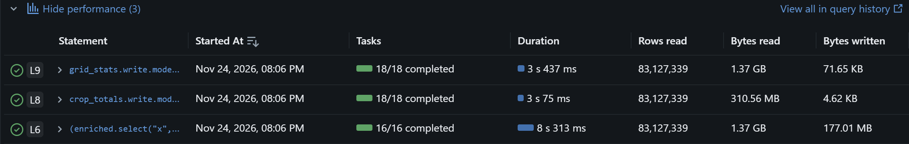
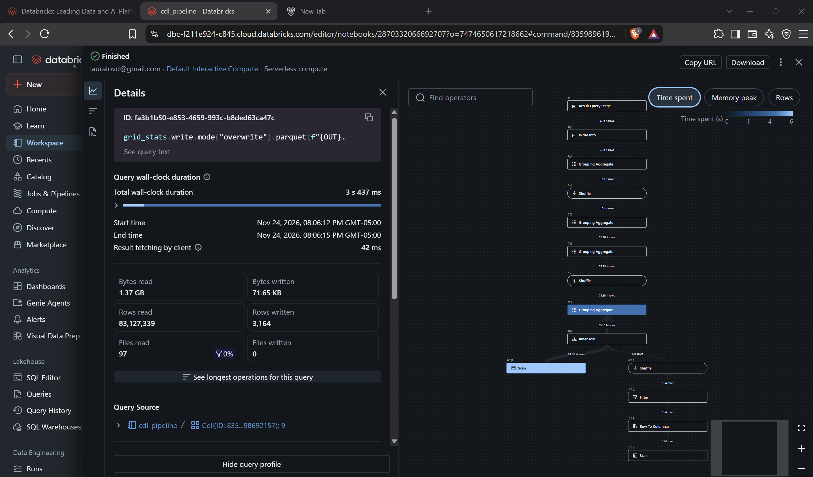
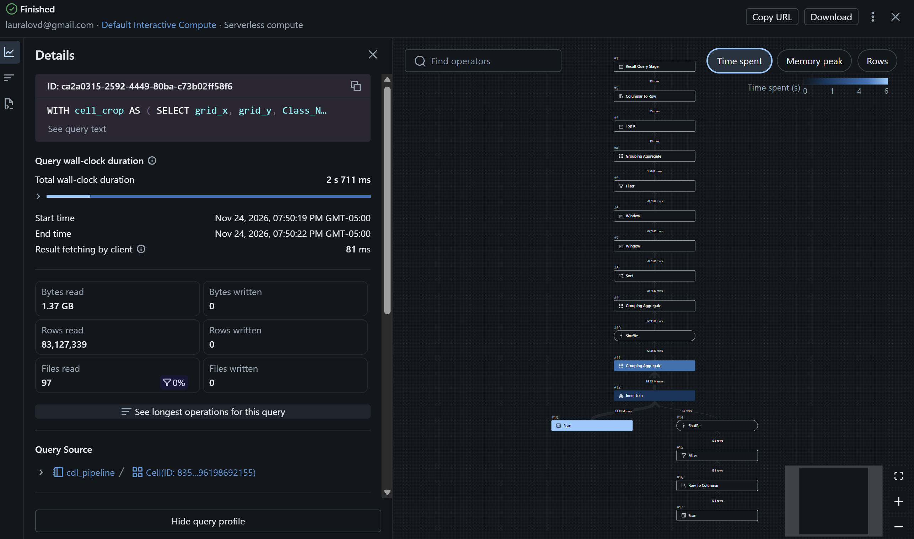

# PySpark Pipeline – USDA Cropland Data Layer 2025

## Dataset
USDA NASS Cropland Data Layer (CDL) 2025, 30 m national GeoTIFF (1.9 GB zipped).
Source: https://www.nass.usda.gov/Research_and_Science/Cropland/
Preprocessing: `scripts/convert_cdl_to_parquet.py` converts the raster to Parquet
(every 4th pixel → 120 m grid, NoData dropped; each row ≈ 1.44 ha). Code lookup from the .vat.dbf.

## Pipeline
Filters → withColumn (grid cells, area, land_group) → broadcast join → groupBy → 3 SQL queries → partitioned Parquet output.

## Performance Analysis

Filters being pushed down mean that, instead of the columns being filtered *after* the data is retrieved, the columns are filtered *before* being read. This makes it faster as less data needs to be read/processed/moved.

The ReadSchema shows that Spark improved performance by reducing the columns that needed to be read. In the non-Spark version,`crop_code`, `x`, and `y` are all read. However, in the Spark version, only column `crop_code` was needed, so only `crop_code` was read.

The biggest bottleneck is the partitioned write in cell 8. This wrote a full table, so this is expected to be a longer process.

The pipeline was optimized in multiple ways. One way of optimizing is by caching the aggregation, which reduces time by avoiding a recomputation. In code chunk 12 this reduced the time from 2 seconds to 0.5-1 second!

## Actions vs Transformations
Transformations defined in 0.0010s: nothing executed yet (lazy).

Action collect() ran the job in 1.63s and returned 29 rows (eager).

## Key Findings
(top crops by area, dominant crop by region, most corn/soy-dominated cells, KMeans clusters)

The top 5 crops in 2025 were:

1. Corn
2. Soybean
3. Winter Wheat
4. Alfalfa
5. Spring Wheat

Corn covers about 39 million ha, while soybeans cover about 31 million ha (about 59 % of actively cultivated land in the US).

*I know I should have more key findings, but I am too brain dead to think*

## Screenshots

